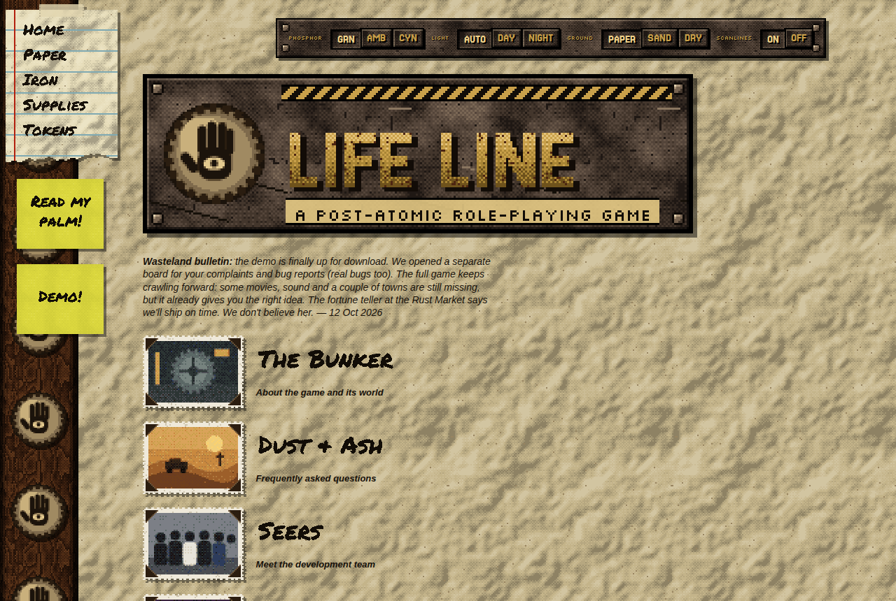
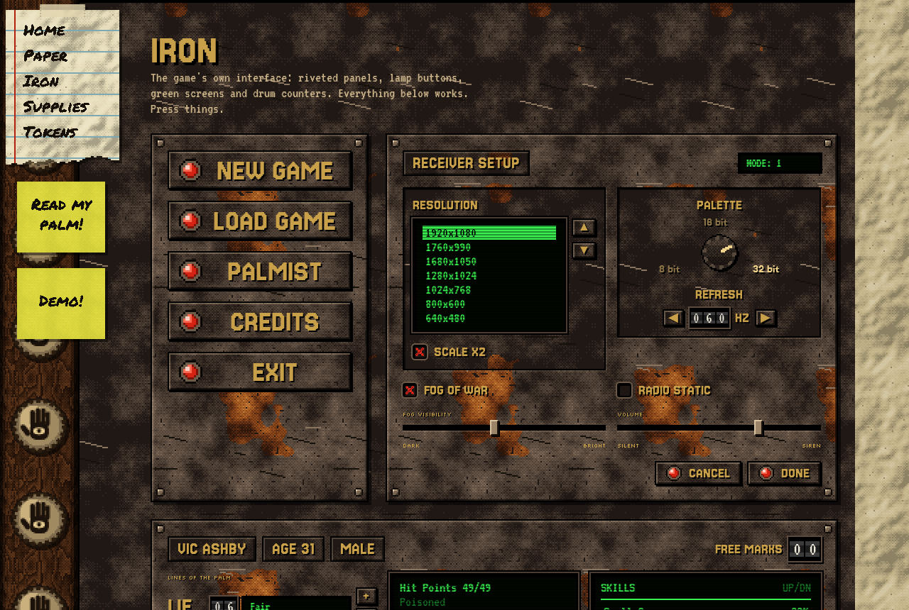
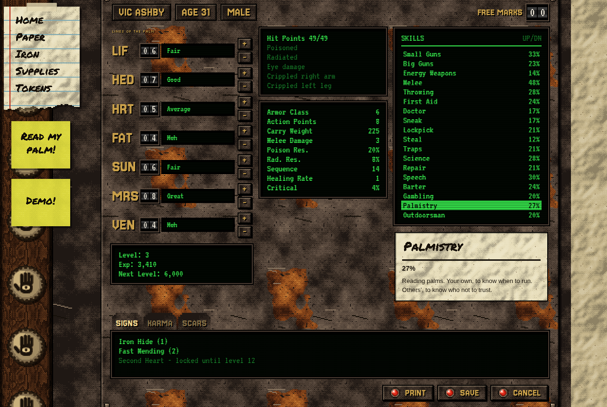
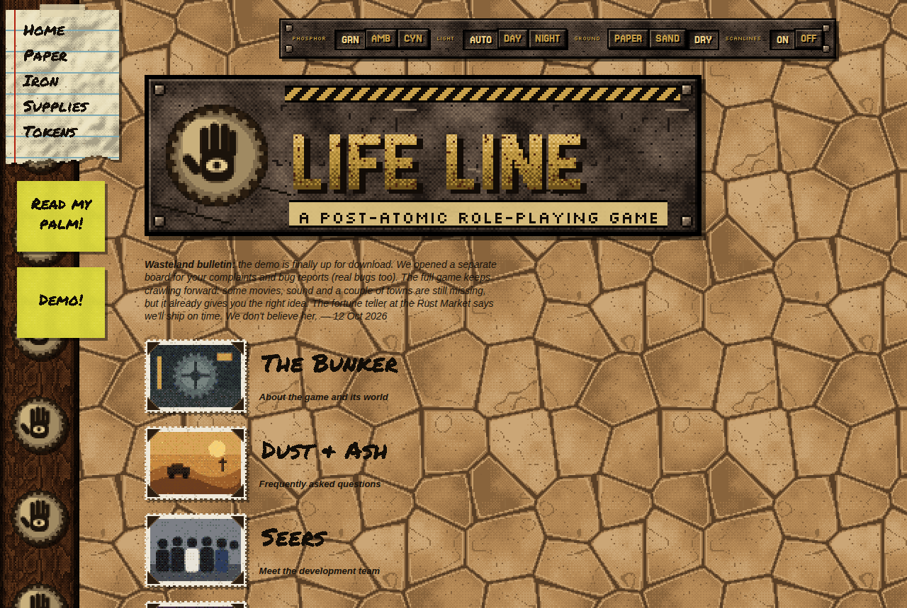
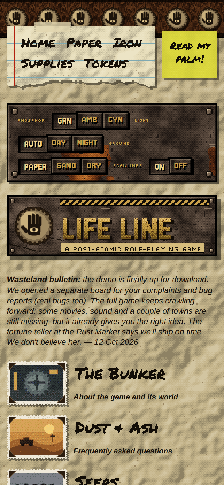

# RUSTOMANCY ✋

**Rust-reading for the end of the world.** A post-atomic, retro-futurist pixel-art theme for **Bootstrap 5.3**. Use it to build 1997-style game websites and gritty in-game interfaces: crumpled paper, marker scrawl, riveted rusty panels, lamp buttons, green phosphor screens and drum counters.

No image files. Every texture, sprite, photo frame and handwritten heading is generated in the browser on a `<canvas>`, palette-quantized, Bayer-dithered and blown up 2× with nearest-neighbour scaling.



| Iron interface | Character sheet |
|---|---|
|  |  |

| Cracked-desert ground | Mobile |
|---|---|
|  |  |

## Two materials

**Paper** is for websites, fan pages and journals. It includes a wooden spine with seals, a taped notebook note for navigation with a pixel-torn edge, sticky notes, marker headings, signatures, photos with album corners, struck-out words with red marker corrections, worn ink stamps and a rating badge.

**Iron** is for the game itself. It includes rusted riveted panels, bevel buttons with red lamps, scanlined CRT screens, drum counters, red-X checkboxes, sliders, a three-frame rotary knob, stepped tabs, an action-point lamp strip and a bottom HUD bar.

Stock Bootstrap components (forms, alerts, badges, progress, tables, dropdowns, list groups, modals, toasts) are skinned for both materials.

## Install

From a CDN (jsDelivr):

```html
<link rel="stylesheet" href="https://cdn.jsdelivr.net/npm/bootstra-rustomancy@0.2/dist/rustomancy.min.css">
<script src="https://cdn.jsdelivr.net/npm/bootstra-rustomancy@0.2/dist/rustomancy.js"></script>
```

From npm:

```sh
npm install bootstrap bootstra-rustomancy
```

The package ships `dist/rustomancy.css`, `dist/rustomancy.min.css` and `dist/rustomancy.js`. Bootstrap 5.3 is a peer dependency.

## Quick start

Load the fonts and Bootstrap first, then the theme:

```html
<link href="https://fonts.googleapis.com/css2?family=Jersey+15&family=Permanent+Marker&family=Reenie+Beanie&family=Silkscreen&family=VT323&display=swap" rel="stylesheet">
<link rel="stylesheet" href="https://cdn.jsdelivr.net/npm/bootstrap@5.3.3/dist/css/bootstrap.min.css">
<link rel="stylesheet" href="https://cdn.jsdelivr.net/npm/bootstra-rustomancy@0.2/dist/rustomancy.min.css">

<!-- ... your markup ... -->

<script src="https://cdn.jsdelivr.net/npm/bootstrap@5.3.3/dist/js/bootstrap.bundle.min.js"></script>
<script src="https://cdn.jsdelivr.net/npm/bootstra-rustomancy@0.2/dist/rustomancy.js"></script>
```

`rustomancy.js` boots on its own. It generates the textures, renders every `.px` element and every `canvas.px-photo`, tears the edges of `.rm-note`, wires up theme buttons, then fires `rustomancy:ready` on `document`.

See `examples/starter.html` for a minimal page and `index.html` for the full demo.

## Project layout

```
src/rustomancy.css     theme styles (load after Bootstrap)
src/rustomancy.js      pixel engine + theme switches, exposes window.Rustomancy
demo/demo.js           logic for the demo page only (logo, character sheet, HUD)
index.html             full demo / living style guide
examples/starter.html  minimal starting point
docs/                  screenshots
scripts/build.mjs      build: src/ → dist/, demo → _site/
```

The theme is part of the [Bootstra Themes](https://github.com/bloschinsky/bootstra-themes) monorepo. From the repository root, `npm run build --workspace bootstra-rustomancy` writes `dist/` (the two source files plus a minified CSS) and the demo site in `_site/`; `npm test --workspace bootstra-rustomancy` lints and builds. `npm run preview` serves the whole collection, with this demo at `themes/bootstra-rustomancy/`.

## Theme switches

Set these attributes on `<html>`, or add buttons with the matching `data-set-*` attribute and RUSTOMANCY wires and remembers them (localStorage).

| Attribute | Values | Button |
|---|---|---|
| `data-phosphor` | `green` · `amber` · `cyan` | `data-set-phos="amber"` |
| `data-theme` | *(auto)* · `light` · `dark` | `data-set-theme="dark"` |
| `data-ground` | *(paper)* · `sand` · `cracked` | `data-set-ground="sand"` |
| `data-scan` | `on` · `off` | `data-set-scan="off"` |

## Key classes

| Class | What it does |
|---|---|
| `.px` | Renders text into a hard-edged canvas; the real text stays for screen readers. `data-text="line one\|line two"` for multi-line. |
| `canvas.px-photo[data-scene][data-w][data-h]` | Dithered pixel snapshot with a torn frame. Scenes: `vault`, `dunes`, `tower`, `market`, `crew`, `duo`. |
| `.rm-spine` `.rm-rail` `.rm-main` | Site frame: wooden spine, fixed note rail, content column |
| `.rm-note` `.rm-tape` `.rm-sticky` | Notebook sheet, tape, sticky note |
| `.rm-scrawl` `.rm-sub` `.rm-sign` `.rm-role` | Marker heading, bold-italic subhead, signature, job title |
| `.rm-fix` `.rm-stamp` `.rm-ratingbox` | Correction, stamp, rating badge |
| `.rm-surface-metal` `.rm-band` `.rm-panel` `.rm-well` | Rust surface, full-width band, riveted panel, sunken bay |
| `.rm-plate` `.rm-label` `.rm-label-sm` `.rm-title-metal` | Stamped plate and embossed labels |
| `.btn-rm` `.btn-rm-led` `.btn-rm-xl` `.btn-rm-xs` | Iron buttons |
| `.btn-scrawl` `.btn-sticky` | Paper buttons |
| `.rm-crt` `.rm-crt-list` `.rm-crt-chip` | CRT screen, selectable list, readout |
| `.rm-drum` `.rm-drum-red` `.rm-drum-lg` | Drum counter |
| `.rm-paper-check` `.rm-range` `.rm-knob` | Paper checkbox, slider, rotary knob (metal checkboxes are styled automatically inside `.rm-surface-metal`) |
| `.rm-tabs` `.rm-leds` `.rm-hud` `.rm-slot` | Stepped tabs, lamp strip, HUD bar, item slot |
| `.alert-rm` `.alert-paper` `.rm-badge` `.rm-progress` `.rm-menu` `.rm-list` | Skins for stock Bootstrap components |
| `.rm-input-paper` `.rm-input-crt` `.rm-card-paper` `.rm-table-paper` `.rm-table-crt` | Forms, cards, tables |

## JavaScript API

```js
Rustomancy.drum(el, 43, 3);          // set a drum counter to 043
Rustomancy.pxText(el);               // (re)render a .px element after changing data-text
Rustomancy.photo(canvas);            // (re)render a .px-photo canvas
Rustomancy.SCENES.ruins = `<rect .../>`; // add your own 160x110 SVG scene, then data-scene="ruins"
Rustomancy.setGround('sand');        // also setPhos / setTheme / setScan
document.addEventListener('rustomancy:ready', () => { /* textures and fonts are ready */ });
```

Low-level helpers (`paint`, `fbm`, `crunch`, `sprite`, `rustTile`, `hazardTile`, `sigil` and others) are exposed for drawing your own pixel art in the same style. `demo/demo.js` uses them to draw the LIFE LINE logo plate.

## Fonts

All fonts come from Google Fonts under the SIL Open Font License: Permanent Marker (headings), Reenie Beanie (signatures), Jersey 15 (plates, buttons), VT323 (screens) and Silkscreen (tiny labels).

## Notes

- Inspired by the look and feel of late-90s post-apocalyptic RPG websites and interfaces. RUSTOMANCY is an original work. It contains no assets from any existing game and is not affiliated with any publisher.
- The demo game "LIFE LINE", its studio and its characters are fictional.
- Works in current Chrome, Edge, Firefox and Safari, and on mobile.

## License

[MIT](LICENSE)
